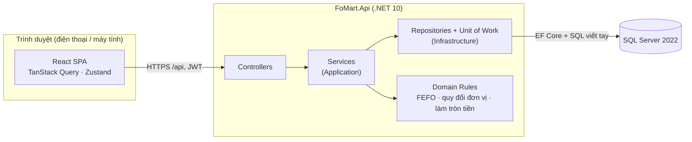

# FoMart

**Quản lý bán hàng và tồn kho theo lô cho tiệm tạp hóa nhỏ.** Bán bằng quét mã vạch ngay trên camera điện thoại, nhập hàng theo lô có hạn dùng, trừ kho FEFO, theo dõi tồn và thẻ kho.

[](https://github.com/lhknguyen15/FoMart/releases)


<p>
  
  
</p>

> Dự án cá nhân. Ảnh chụp dùng dữ liệu mẫu. Bản mới nhất và ghi chú từng bản ở mục [Releases](https://github.com/lhknguyen15/FoMart/releases).

## Bài toán

Tiệm tạp hóa 1–5 người với 300–1.000 mã hàng thường bán bằng trí nhớ, sổ tay hoặc phần mềm tính tiền không quản lý lô: không biết hàng nào sắp hết hạn, tồn kho lệch dần mà không rõ vì sao, nhập hàng theo cảm tính. FoMart nhắm vào ba việc:

- **Bán nhanh ở quầy** (1–3 món tiền mặt trong khoảng 5 giây) bằng điện thoại có sẵn, không bắt buộc mua máy quét.
- **Tồn kho đúng theo lô**: mỗi lần nhập là một lô có hạn dùng và giá vốn; bán trừ lô hết hạn trước (FEFO); mọi thay đổi tồn đều có chứng từ.
- **Không chặn việc bán** khi số liệu chưa khớp: tồn âm được ghi nhận và đánh dấu cần kiểm kê, thay vì bắt khách chờ.

## Tính năng (v0.2.0)

| Mảng | Có gì |
| --- | --- |
| **Bán hàng** | Quét bằng camera (zxing-cpp WebAssembly), máy quét cầm tay dạng bàn phím, chụp ảnh mã, tìm tên không dấu · tiền mặt một chạm + tiền thối · chuyển khoản với **mã VietQR** · hàng chưa khai báo · hủy hóa đơn bằng chứng từ đảo ngược |
| **Nhập hàng** | Phiếu nháp lưu trên server · đơn vị nhập mặc định (thùng) · gợi ý giá lần trước · hạn dùng + số lô · chọn vị trí nhận · tạo nhanh sản phẩm khi quét mã mới · ẩn giá nhập với nhân viên |
| **Tồn kho** | Lọc sắp hết / tồn âm / cần kiểm kê · tồn theo vị trí và theo lô với cảnh báo "sắp hết hạn", "đã hết hạn" · **thẻ kho** mở được hóa đơn, phiếu nhập gốc |
| **Hóa đơn** | Lọc theo ngày, trạng thái, hình thức · chi tiết có lô đã trừ, giá vốn, lãi gộp (chỉ người được phép xem) |
| **Tài khoản** | Chủ tiệm và nhân viên · máy nhớ người dùng + bàn phím PIN đổi ca · JWT + refresh token xoay vòng |
| **Giao diện** | Điện thoại: khung tác vụ, nút to vùng ngón cái · máy tính (≥ 1024px): khung quản lý kiểu dashboard với menu bên và bảng |

<details>
<summary>Thêm ảnh chụp</summary>

| Hóa đơn | Tồn kho, lọc "Sắp hết" |
| --- | --- |
|  |  |
| **Lô và thẻ kho** | **Phiếu nhập nháp** |
|  |  |

</details>

## Công nghệ

| Phần | Dùng |
| --- | --- |
| Backend | ASP.NET Core Web API (.NET 10), Clean Architecture, EF Core **database-first** + SQL viết tay cho trừ kho, Repository + Unit of Work, JWT có vai trò, rate limiting, Serilog, Swagger, health check |
| Database | SQL Server 2022 (Docker khi dev), migration SQL viết tay có checksum, trigger giữ tồn khớp sổ kho, collation tìm không dấu tiếng Việt |
| Frontend | Vite + React 19 + TypeScript, Tailwind CSS v4, React Router, TanStack Query, Zustand, React Hook Form + Zod, Phosphor Icons |
| Quét mã | `barcode-detector` (zxing-cpp WebAssembly), file `.wasm` tự phục vụ, tải lười khi bật camera |

## Kiến trúc



- **Chiều phụ thuộc:** `Api → Infrastructure → Application → Domain`; Domain không phụ thuộc thư viện nào, quy tắc nghiệp vụ thuần nằm ở `Domain/Rules` để test được. Chi tiết: [ADR-0001](docs/adr/0001-clean-architecture-database-first.md).
- **Sổ kho là nguồn sự thật:** mọi thay đổi tồn đi qua một chứng từ và ghi vào `stock_moves` (chỉ thêm, không sửa, không xóa); trigger cộng vào `stock`, ứng dụng không được ghi thẳng `stock`. Hủy chứng từ bằng chứng từ đảo ngược. Đối soát sổ kho với tồn có sẵn API.
- **Bán ngoại tuyến được về sau:** id hóa đơn là UUID v7 sinh trên máy bán, gửi lại cùng id không ghi trùng.
- **Một khuôn phản hồi** `HTTPResponseData<T>` cho mọi API, kể cả lỗi; thông báo tiếng Việt.

## Chạy thử trên máy

**Cần có:** Docker Desktop, .NET SDK 10.0.101 (xem `backend/global.json`), Node.js ≥ 22.22 (khuyên dùng 24 LTS), PowerShell (Windows) để chạy script migrate.

```powershell
# 1. SQL Server trong Docker (cổng 14330)
Copy-Item .env.example .env           # rồi đặt MSSQL_SA_PASSWORD trong .env
docker compose up -d

# 2. Database + dữ liệu mẫu
./database/migrate.ps1 -Docker -Seed

# 3. Backend: chuỗi kết nối và khóa ký JWT để trong User Secrets (không commit)
dotnet user-secrets set "ConnectionStrings:FoMart" "Server=localhost,14330;Database=FoMart;User Id=sa;Password=<mật khẩu SA>;TrustServerCertificate=True" --project backend/FoMart.Api
dotnet user-secrets set "Jwt:SigningKey" "<chuỗi ngẫu nhiên ≥ 32 ký tự>" --project backend/FoMart.Api
dotnet run --project backend/FoMart.Api   # http://localhost:5224, Swagger ở /swagger

# 4. Frontend (cửa sổ khác)
cd frontend
npm install
npm run dev                               # https://localhost:5173
```

Frontend chạy HTTPS (camera điện thoại chỉ hoạt động qua HTTPS) và proxy `/api` sang backend, nên điện thoại cùng Wi-Fi mở địa chỉ "Network" mà Vite in ra là dùng được. Trình duyệt sẽ cảnh báo chứng chỉ tự ký khi dev: chọn tiếp tục.

**Tài khoản mẫu:** chủ tiệm `0900000001` / `Test@123` (PIN `1234`), nhân viên `0900000002` / PIN `1234`. Mã vạch mẫu: lon Cola `8930000000017`, lốc `8930000000024`, thùng `8930000000031`.

## Cấu trúc repo

```
backend/    FoMart.Domain · FoMart.Application · FoMart.Infrastructure · FoMart.Api
database/   migrations/Vxxx__*.sql, seed/, migrate.ps1
frontend/   src/app · api · features/<mảng> · components/ui · stores · lib
docs/       spec.md, database.md, module-workflows.md, adr/, module-notes/
PRODUCT.md, DESIGN.md   định hướng sản phẩm và hệ thống thiết kế giao diện
```

## Tài liệu

- [Đặc tả](docs/spec.md): phạm vi, 11 use case, quy tắc nghiệp vụ (BR), yêu cầu phi chức năng, màn hình, lộ trình.
- [Thiết kế database](docs/database.md) và [sơ đồ luồng từng module](docs/module-workflows.md).
- Quyết định kỹ thuật: [ADR-0001 kiến trúc backend](docs/adr/0001-clean-architecture-database-first.md), [ADR-0002 database](docs/adr/0002-database-design.md), [ADR-0003 quét mã bằng camera](docs/adr/0003-barcode-scanning.md), [ADR-0004 tự xác nhận chuyển khoản qua SePay](docs/adr/0004-sepay-transfer-confirmation.md).
- [Hệ thống thiết kế](DESIGN.md) và [định hướng sản phẩm](PRODUCT.md).
- [Ghi chú từng mảng](docs/module-notes/): file đã tạo, quyết định, lỗi gặp phải, cách kiểm tra.

## Lộ trình

| Giai đoạn | Nội dung | Trạng thái |
| --- | --- | --- |
| 1 – Nền tảng | Database, khung backend, danh mục, đăng nhập, API nhập hàng + lõi kho | [v0.1.0](https://github.com/lhknguyen15/FoMart/releases/tag/v0.1.0) |
| 2 – Nhập và bán | Bán hàng FEFO + VietQR, nhập hàng, hóa đơn, tồn kho + thẻ kho, giao diện | [v0.2.0](https://github.com/lhknguyen15/FoMart/releases/tag/v0.2.0) |
| 3 – Giữ dữ liệu đúng | Màn hình hạn dùng, xuất hủy, kiểm kê và duyệt chênh lệch | Đang làm |
| 4 – Báo cáo | Tổng quan, doanh thu, lãi gộp, bán chạy, gợi ý đặt hàng | |
| 5 – Minimart | Chuyển kho nhiều vị trí, cập nhật thời gian thực (SignalR), tự xác nhận chuyển khoản (SePay) | |
| 6 – Hoàn thiện | Bán ngoại tuyến (PWA, IndexedDB), xuất Excel, chạy thử tại tiệm thật | |

Sau cùng: app riêng cho điện thoại dùng chung backend, quét mã bằng camera native.

## Cách làm việc

- **Git flow rút gọn:** nhánh `feature/*`, `fix/*`, `docs/*` → PR vào `develop` (squash); cuối mỗi giai đoạn PR `develop` → `main` (merge commit) và gắn tag `v0.<giai đoạn>.0` kèm GitHub Release.
- **Conventional Commits**, mỗi PR ghi use case / quy tắc nghiệp vụ liên quan.
- Mỗi tính năng: kịch bản HTTP chạy trên database tạm (gửi đúng request mà giao diện gửi), ảnh chụp giao diện ở cỡ điện thoại và máy tính, đối soát sổ kho phải khớp; backend build 0 cảnh báo, frontend build + lint sạch.

---

<details>
<summary>English summary</summary>

FoMart is a personal portfolio project: a sales and lot-based inventory web app for small Vietnamese grocery stores. Cashiers scan barcodes with the phone camera (zxing-cpp WebAssembly) or a keyboard-wedge scanner, take cash or VietQR bank transfers, and stock is deducted first-expired-first-out from lots created at receiving. Every stock change goes through a document into an append-only ledger (`stock_moves`), reversals are new documents, and negative stock is allowed but flagged for counting instead of blocking a sale. Backend: ASP.NET Core (.NET 10), Clean Architecture, EF Core database-first, SQL Server 2022. Frontend: React 19 + TypeScript, Tailwind CSS v4, TanStack Query, Zustand, React Hook Form + Zod. See [Releases](https://github.com/lhknguyen15/FoMart/releases) for what each version contains.

</details>
