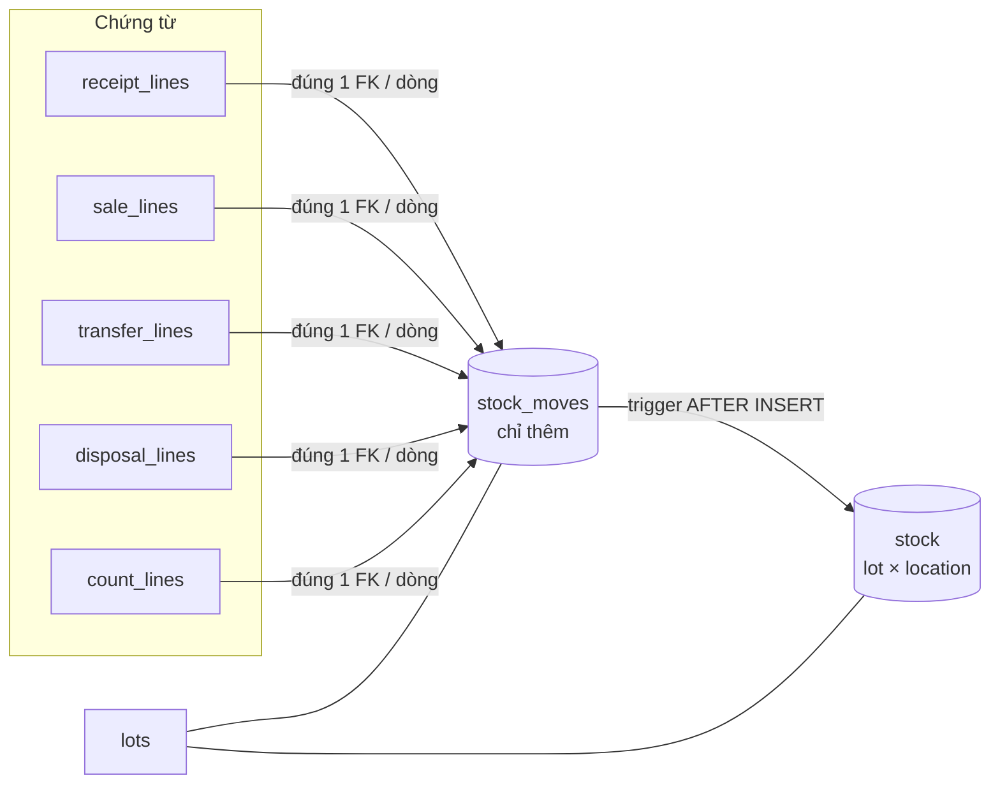
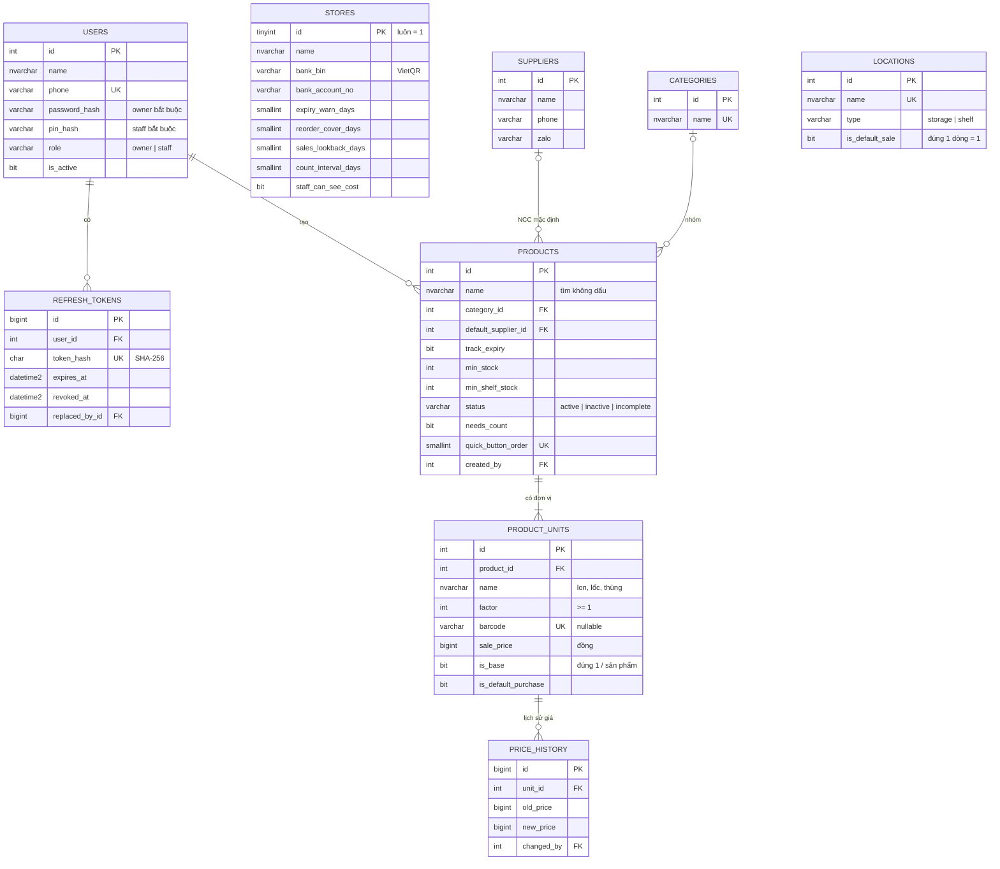
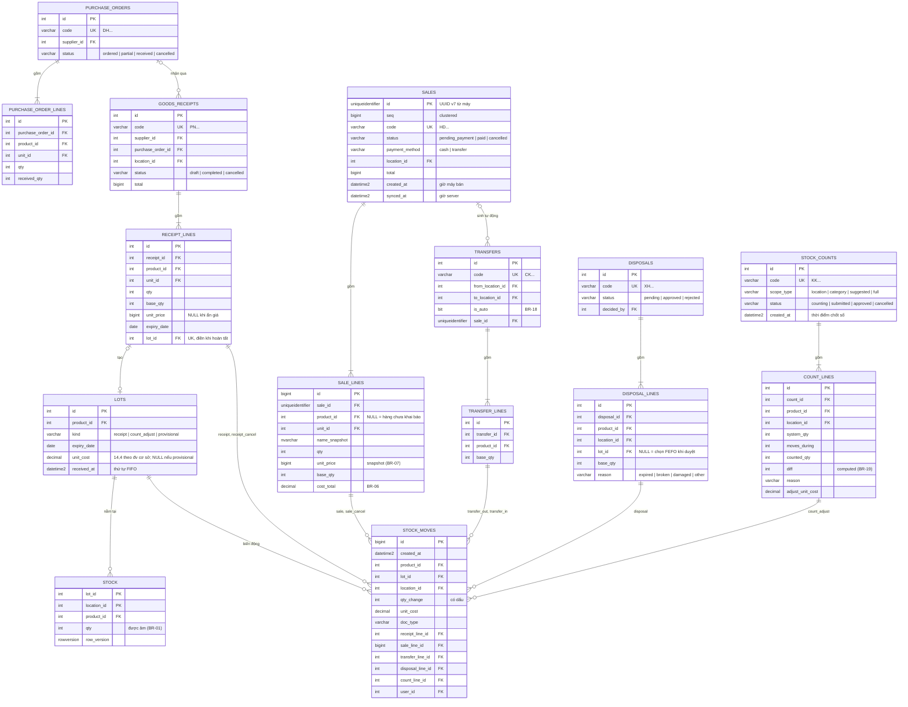

# Thiết kế database FoMart

Nguồn sự thật của schema là các script trong [`database/migrations/`](../database/migrations/) (database-first, xem [ADR-0001](adr/0001-clean-architecture-database-first.md)). Tài liệu này giải thích cấu trúc; lý do của từng lựa chọn nằm ở [ADR-0002](adr/0002-database-design.md). Spec mục 9 là thiết kế ban đầu; chỗ nào khác nhau thì theo tài liệu này.

## 1. Tổng quan

| Schema | Bảng | Vai trò |
| --- | --- | --- |
| `auth` | `users`, `refresh_tokens` | Tài khoản chủ/nhân viên, phiên JWT |
| `core` | `stores` | Cấu hình cửa hàng (đúng một dòng ở phiên bản 1) |
| `catalog` | `categories`, `suppliers`, `locations`, `products`, `product_units`, `price_history` | Danh mục (UC-01, UC-02) |
| `inventory` | `lots`, `stock`, `stock_moves`, `transfers`, `transfer_lines`, `disposals`, `disposal_lines`, `stock_counts`, `count_lines` | Lô, tồn, sổ kho, chuyển kho, hủy, kiểm kê |
| `purchasing` | `purchase_orders`, `purchase_order_lines`, `goods_receipts`, `receipt_lines` | Đặt hàng, nhập hàng (UC-03, UC-04) |
| `sales` | `sales`, `sale_lines` | Bán hàng, hủy hóa đơn (UC-05, UC-06) |

Trái tim là bộ ba **`lots` → `stock_moves` → `stock`**. Ứng dụng chỉ **thêm dòng vào `stock_moves`**. Trigger cộng dòng đó vào `stock`, nên tồn không thể lệch khỏi sổ (BR-02).



## 2. Sơ đồ quan hệ

### 2.1. Danh mục và tài khoản



### 2.2. Tồn kho và chứng từ



Không vẽ để sơ đồ dễ đọc: mọi bảng chứng từ có `created_by` và các cột người duyệt/hủy trỏ về `users`. `stock`, `stock_moves`, các dòng chứng từ cũng có FK tới `products` và `locations`.

## 3. `doc_type` trong sổ kho

| doc_type | Dấu `qty_change` | FK được điền | Phát sinh khi |
| --- | --- | --- | --- |
| `receipt` | + | `receipt_line_id` | Hoàn tất phiếu nhập |
| `receipt_cancel` | − | `receipt_line_id` | Hủy phiếu nhập (lô chưa bị trừ) |
| `sale` | − | `sale_line_id` | Hóa đơn chuyển sang `paid` |
| `sale_cancel` | + | `sale_line_id` | Hủy hóa đơn, trả đúng các lô đã trừ |
| `transfer_out` / `transfer_in` | − / + | `transfer_line_id` | Chuyển kho (thủ công hoặc tự động BR-18) |
| `disposal` | − | `disposal_line_id` | Phiếu hủy được duyệt |
| `count_adjust` | ± | `count_line_id` | Duyệt chênh lệch kiểm kê, tồn đầu kỳ |

Mỗi dòng sổ có đúng một FK chứng từ được điền và phải khớp với `doc_type` (`CK_stock_moves_doc_ref`), nên không có dòng sổ "mồ côi".

## 4. Quy tắc nghiệp vụ được ép ở đâu

Database ép những gì nó ép được một cách rẻ và chắc chắn; còn lại do ứng dụng kiểm tra (`Domain/Rules` và `Application/Services`). Ứng dụng vẫn phải kiểm tra trước để báo lỗi thân thiện; ràng buộc DB là lưới an toàn cuối cùng.

| Quy tắc | Database | Ứng dụng |
| --- | --- | --- |
| BR-02 tồn chỉ đổi qua chứng từ | Trigger `TR_stock_moves_apply`; role `fomart_app` bị `DENY` ghi `stock` | Mọi nghiệp vụ đổi tồn đi qua `unitOfWork.StockRepository` |
| NFR-10 sổ chỉ thêm | Trigger `TR_stock_moves_append_only`; `DENY UPDATE, DELETE` | |
| BR-03 chứng từ đã hoàn tất không sửa | CHECK trạng thái + cột người/thời điểm | Chặn sửa dòng khi `status <> 'draft'` |
| BR-04 FEFO/FIFO | Index `IX_lots_product_expiry` | SQL chọn lô trong `StockRepository`, chia lô bằng `Domain/Rules/FefoAllocator` |
| BR-09 một đơn vị cơ sở | `UX_product_units_base`, `CK_product_units_base_factor` | Tạo đơn vị cơ sở cùng sản phẩm |
| BR-10 hệ số nguyên dương | `CK_product_units_factor` | |
| BR-11 kiểu tiền | `BIGINT` cho tiền, `DECIMAL(14,4)` cho giá vốn | Làm tròn khi chia |
| BR-12 khóa hệ số khi có giao dịch | Trigger `TR_product_units_lock_factor` | Ẩn ô sửa trên UI |
| BR-16 vị trí bán mặc định là kệ | `UX_locations_default_sale`, `CK_locations_default_sale_is_shelf` | Không cho xóa/tắt vị trí bán cuối cùng |
| BR-19 công thức chênh lệch | Cột tính `count_lines.diff` | Tính `moves_during` khi gửi |
| BR-20 mã vạch duy nhất | `UX_product_units_barcode` (filtered) | |
| Nguyên nhân khớp chiều lệch | `CK_count_lines_reason_sign` | |
| Lô thuộc đúng sản phẩm | FK ghép `(lot_id, product_id)`, `(unit_id, product_id)` | |
| BR-01, 05, 06, 07, 13, 15, 17, 18, 21 | | `Domain/Rules`, `Application/Services` |

## 5. Trừ kho (phác thảo cho `StockRepository`)

Service mở `unitOfWork.BeginWriteAsync` rồi gọi `unitOfWork.StockRepository`; tất cả chạy trong một transaction (NFR-06):

1. Khóa các dòng tồn của sản phẩm tại vị trí theo thứ tự `product_id` tăng dần, để hai máy bán cùng lúc không deadlock:
   ```sql
   SELECT s.lot_id, s.qty, l.expiry_date, l.received_at, l.unit_cost, l.kind
   FROM inventory.stock AS s WITH (UPDLOCK, ROWLOCK)
   JOIN inventory.lots  AS l ON l.id = s.lot_id
   WHERE s.product_id = @productId AND s.location_id = @locationId
   ORDER BY CASE WHEN l.kind = 'provisional' THEN 1 ELSE 0 END,
            CASE WHEN l.expiry_date IS NULL THEN 1 ELSE 0 END,
            l.expiry_date, l.received_at, l.id;        -- FEFO, rồi FIFO
   ```
2. `Domain/Rules/FefoAllocator` (thuần C#) chia số lượng cần trừ vào các lô. Lô còn hạn được ưu tiên (BR-05). Nếu không đủ thì phần thiếu trừ vào lô mới nhất tại vị trí đó, cho phép âm (BR-01). Nếu vị trí chưa từng có lô nào của sản phẩm thì trừ vào **lô tạm** của sản phẩm (tạo nếu chưa có).
3. Insert các dòng `stock_moves`; trigger tự cập nhật `stock`.
4. Đặt `products.needs_count = 1` nếu có lô bị âm hoặc phải dùng lô tạm.

Kệ thiếu mà kho sau còn hàng (BR-18): tạo `transfers` (`is_auto = 1`) trước bước 1, trong cùng transaction.

## 6. Database-first: chạy script và scaffold

```powershell
# Tạo database FoMart trong container Docker và chạy migration, kèm dữ liệu mẫu
./database/migrate.ps1 -Docker -Seed

# Scaffold lại sau mỗi migration (chạy ở thư mục backend/; dotnet-ef ghim trong .config/dotnet-tools.json)
dotnet ef dbcontext scaffold "Name=ConnectionStrings:FoMart" Microsoft.EntityFrameworkCore.SqlServer `
  --project FoMart.Infrastructure --startup-project FoMart.Api `
  --context FoMartDbContext --context-dir DbContext --context-namespace FoMart.Infrastructure `
  --output-dir ../FoMart.Domain/Entities --namespace FoMart.Domain.Entities `
  --schema auth --schema core --schema catalog --schema inventory --schema purchasing --schema sales `
  --no-onconfiguring --force
```

Đã thử với EF Core 10 trên schema này. Scaffold tự sinh `HasTrigger(...)` cho `stock_moves` và `product_units`, giữ `HasComputedColumnSql` cho `diff`, `IsRowVersion()` cho `row_version` và default sinh mã từ sequence.

Quy tắc:

- Thay đổi schema = thêm file `database/migrations/V00x__mo_ta.sql` mới. Không sửa file đã áp dụng, vì `migrate.ps1` sẽ báo lệch checksum.
- Không sửa tay file scaffold (`Domain/Entities/*.cs`, `Infrastructure/DbContext/FoMartDbContext.cs`). Quy tắc nghiệp vụ viết ở `Domain/Rules`; cấu hình EF bổ sung (value converter, query filter) viết ở `Infrastructure/DbContext/FoMartDbContext.Custom.cs` qua `OnModelCreatingPartial`.

## 7. Quy ước

- Tên bảng/cột `snake_case` tiếng Anh. EF scaffold tự đổi sang PascalCase.
- Trạng thái là `VARCHAR` + `CHECK`. Domain giữ hằng số trùng khớp (ví dụ `SaleStatus.Paid = "paid"`).
- Thời điểm là `DATETIME2(3)` UTC; chỉ đổi sang giờ Việt Nam khi hiển thị và khi gom báo cáo theo ngày. Hạn dùng là `DATE`.
- Tiền là `BIGINT` (đồng); giá vốn `DECIMAL(14,4)`; tổng giá vốn `DECIMAL(18,4)`; số lượng `INT` theo đơn vị cơ sở.
- Mã chứng từ sinh bằng sequence: `DH` đặt hàng, `PN` nhập, `HD` hóa đơn, `CK` chuyển kho, `XH` xuất hủy, `KK` kiểm kê, kèm 8 chữ số.
- Collation cả database là `Latin1_General_100_CI_AI`. Bảng `#temp` khai báo cột chuỗi bằng `COLLATE DATABASE_DEFAULT`.
- Tên ràng buộc: `PK_`, `FK_`, `UQ_`, `UX_` (unique index), `IX_`, `CK_`, `DF_`, `TR_`, `v_` (view).
