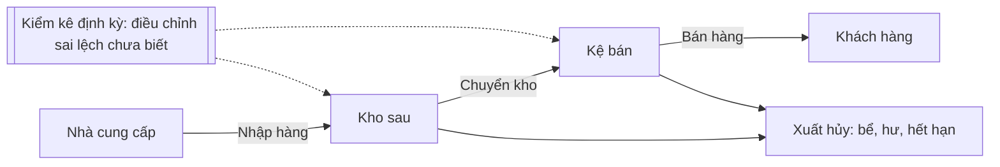
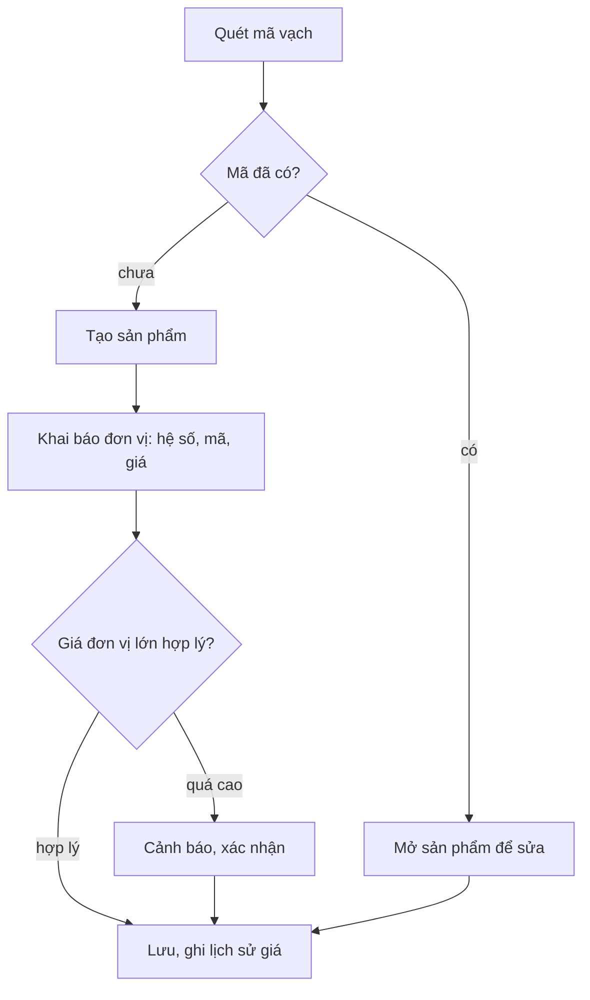
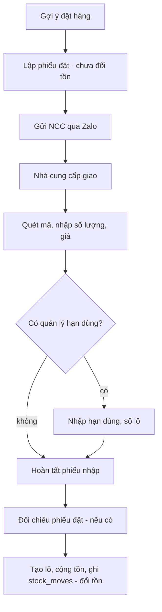
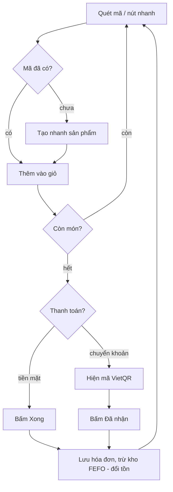
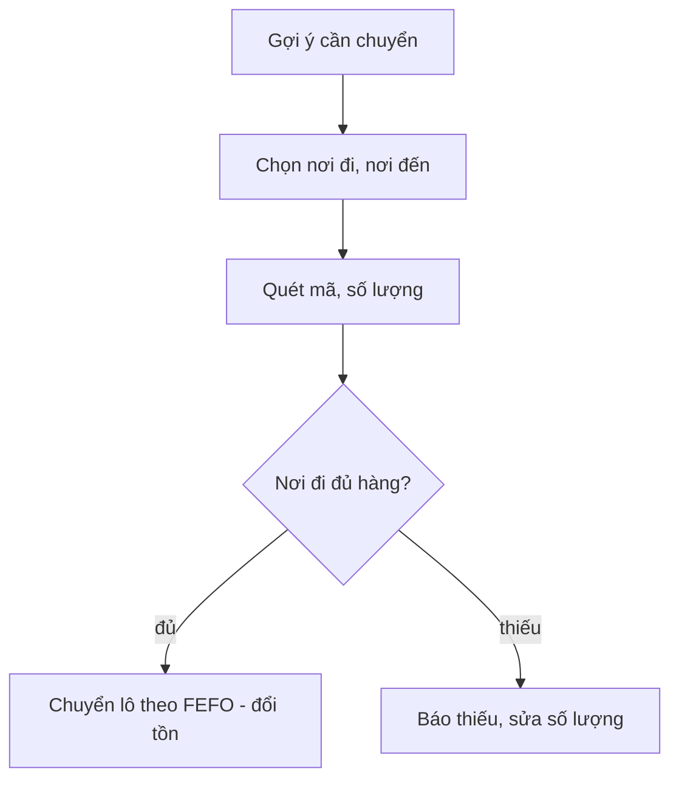
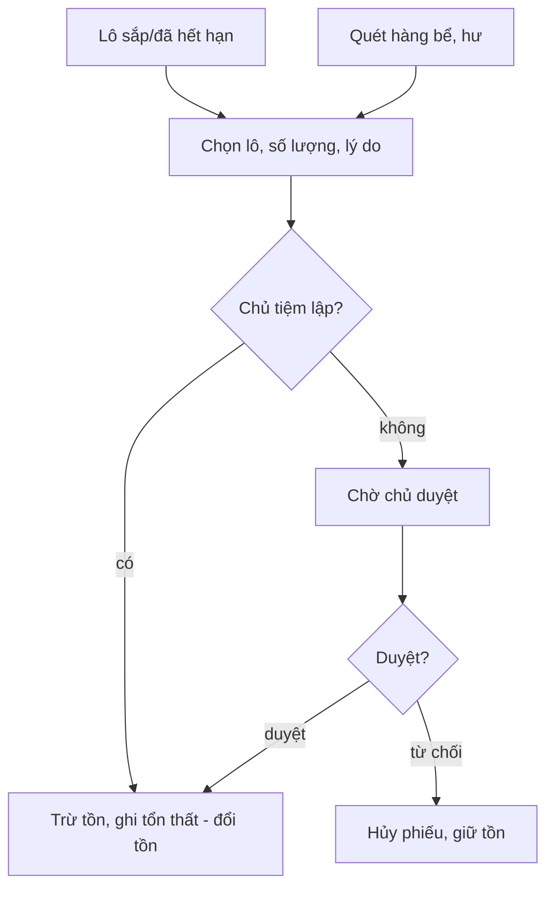
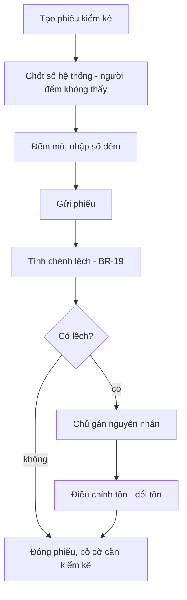

# Sơ đồ workflow theo module

Bản có hình vẽ: https://claude.ai/artifact/DszUWnwqBqLE91zYA5Nd2v (mục 13). Bản dưới đây dùng Mermaid để đọc được trong repo. Bước có ghi chú "(đổi tồn)" là bước làm thay đổi tồn kho.

## Luồng hàng tổng quát

Tiệm chỉ có một vị trí thì kho sau và kệ bán là một, bước chuyển kho biến mất.

## 13.1. Danh mục sản phẩm (UC-01)

Đã có giao dịch thì khóa hệ số quy đổi (BR-12).

## 13.2. Đặt hàng và nhập hàng (UC-03, UC-04)

Có thể bắt đầu thẳng từ "Nhà cung cấp giao" mà không cần phiếu đặt. Giá vốn quy về đơn vị cơ sở (BR-11).

## 13.3. Bán hàng (UC-05)

Tồn không đủ không chặn bán: tự chuyển kho (BR-18) hoặc đánh dấu "cần kiểm kê" (BR-01). Khách chưa chuyển khoản xong thì giữ giỏ ở trạng thái "chờ thanh toán".

## 13.4. Chuyển kho (UC-07)

Chỉ hiện khi có từ 2 vị trí (BR-16). Bán hàng thiếu trên kệ cũng tự tạo phiếu này (BR-18).

## 13.5. Xuất hủy (UC-08)

## 13.6. Kiểm kê (UC-09)

Nguyên nhân: âm → bán không ghi nhận / thất thoát / không rõ; dương → nhập hàng chưa ghi. Chênh lệch = số đếm − (số hệ thống lúc tạo phiếu + biến động trong lúc đếm).
