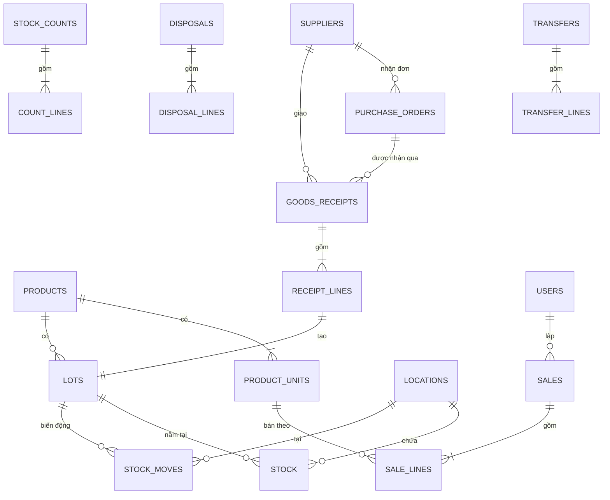

# Đặc tả hệ thống quản lý tiệm tạp hóa

Cập nhật: 28/11/2026 · Bản gốc có sơ đồ: https://claude.ai/artifact/DszUWnwqBqLE91zYA5Nd2v

## 1. Tổng quan

Hệ thống là một web app giúp tiệm tạp hóa biết chính xác tồn kho, bán hàng bằng quét mã vạch và nhập hàng dựa trên dữ liệu bán thực tế. Nó chạy được chỉ với một chiếc điện thoại.

### 1.1. Bối cảnh

Tiệm tạp hóa nhỏ có từ 1 đến khoảng 5 người, khoảng 300–1.000 mã hàng, thường ghi chép bằng sổ hoặc Excel. Người bán quen kiểu đưa hàng, nhẩm giá và nhận tiền trong vài giây.

Từ ngày 1/1/2026, hộ kinh doanh không còn nộp thuế khoán mà tự kê khai theo doanh thu thực tế (Nghị quyết 198/2025/QH15). Vì vậy, chủ tiệm cần biết doanh thu thật.

### 1.2. Vấn đề cần giải quyết

- Không biết chính xác còn bao nhiêu hàng và hàng đang nằm ở đâu.
- Hàng hết hạn mới phát hiện, gây tổn thất.
- Nhập hàng theo cảm tính, lúc thiếu lúc thừa.
- Không biết lãi thật của từng mặt hàng.

### 1.3. Mục tiêu

1. Tồn kho theo thời gian thực, theo từng vị trí và từng lô.
2. Giảm hàng hết hạn nhờ trừ kho theo FEFO và cảnh báo sớm.
3. Gợi ý đặt hàng dựa trên lượng bán thực tế.
4. Bán hàng nhanh: một lượt bán 1–3 món trả tiền mặt xong trong khoảng 5 giây.
5. Phát hiện và định lượng sai lệch (quên ghi bán, thất thoát) qua kiểm kê định kỳ.

### 1.4. Các quyết định đã chốt

| # | Quyết định | Nội dung |
| --- | --- | --- |
| 1 | Thiết bị | Không cố định thiết bị. Điện thoại có camera là mức tối thiểu, hỗ trợ thêm máy quét USB/Bluetooth |
| 2 | Đơn vị tính | Tồn kho tính theo đơn vị cơ sở, giá bán đặt riêng cho từng đơn vị |
| 3 | Ghi nhận bán | Phương án C: bán hàng nhanh, xuất hủy cho hư hỏng đã biết, kiểm kê định kỳ cho sai lệch chưa biết |
| 4 | Thanh toán | Tiền mặt hoặc chuyển khoản VietQR. Mặc định nhân viên tự xác nhận; tiệm có thể bật tự xác nhận qua SePay (ADR-0004, giai đoạn 5) |
| 5 | Đối tượng | Cả tiệm truyền thống lẫn minimart nhỏ, khác nhau bằng cấu hình |

## 2. Phạm vi

Phiên bản 1 phục vụ một cửa hàng duy nhất, từ 1 đến khoảng 5 người dùng, và bao trọn luồng nhập – tồn – bán – kiểm kê.

### 2.1. Trong phạm vi

- Danh mục: sản phẩm, nhóm hàng, đơn vị quy đổi, mã vạch, nhà cung cấp, vị trí.
- Nhập hàng, có hoặc không có phiếu đặt hàng trước.
- Bán hàng nhanh bằng quét mã, nút bấm nhanh hoặc tìm theo tên.
- Thanh toán tiền mặt hoặc chuyển khoản VietQR, xác nhận thủ công; tùy chọn tự xác nhận qua webhook SePay (ADR-0004).
- Quản lý lô và hạn dùng, trừ kho theo FEFO hoặc FIFO.
- Chuyển hàng giữa các vị trí (kho sau sang kệ).
- Xuất hủy hàng bể, hư, hết hạn.
- Kiểm kê từng phần và xử lý chênh lệch.
- Gợi ý đặt hàng, cảnh báo sắp hết hàng và sắp hết hạn.
- Báo cáo doanh thu, lãi gộp, tồn kho, tổn thất, tỷ lệ ghi nhận.
- Phân quyền hai vai trò: chủ tiệm và nhân viên.

### 2.2. Ngoài phạm vi (phiên bản 1)

- Nhiều chi nhánh.
- Kế toán, công nợ nhà cung cấp, kê khai thuế, hóa đơn điện tử.
- Tích hợp trực tiếp API ngân hàng hoặc cổng thanh toán thu hộ (VNPay, MoMo). Tự xác nhận qua SePay thì nằm trong phạm vi, xem ADR-0004.
- Khách trả hàng, đổi hàng.
- Hàng bán theo cân ký.
- Tích điểm, khuyến mãi, khách hàng thân thiết.
- Giao hàng, đặt hàng online từ khách.
- Máy in hóa đơn, ngăn kéo tiền.

### 2.3. Giả định

- Phần lớn hàng đóng gói đã có mã EAN-13 của nhà sản xuất, tiệm không cần dán nhãn mới.
- Cửa hàng có kết nối Internet phần lớn thời gian; màn hình bán hàng vẫn phải chạy được khi mất mạng tạm thời.
- Người bán đôi khi sẽ quên ghi lượt bán; hệ thống chấp nhận điều này và bù bằng kiểm kê.

## 3. Người dùng và phân quyền

Hệ thống có hai vai trò. Tiệm chỉ có một người thì chỉ cần tài khoản chủ tiệm, và mọi chứng từ do chủ lập được tự động duyệt.

| Chức năng | Chủ tiệm | Nhân viên |
| --- | --- | --- |
| Bán hàng | Có | Có |
| Hủy hóa đơn đã hoàn tất | Có | Không |
| Tạo, sửa sản phẩm và giá bán | Có | Chỉ tạo nhanh khi quét ra mã mới, chờ chủ duyệt giá |
| Nhập hàng | Có | Có, không thấy giá nhập nếu chủ tắt quyền |
| Chuyển kho | Có | Có |
| Lập phiếu hủy | Có | Có, chờ chủ duyệt |
| Lập phiếu kiểm kê, nhập số đếm | Có | Có |
| Duyệt chênh lệch kiểm kê | Có | Không |
| Gợi ý và phiếu đặt hàng | Có | Không |
| Báo cáo doanh thu | Có | Chỉ doanh thu ca của mình |
| Báo cáo lãi, giá vốn | Có | Không |
| Quản lý tài khoản, cấu hình cửa hàng | Có | Không |

Khách hàng không dùng hệ thống ở phiên bản 1; họ chỉ thấy mã VietQR khi trả bằng chuyển khoản.

## 4. Thuật ngữ

| Thuật ngữ | Nghĩa |
| --- | --- |
| Đơn vị cơ sở | Đơn vị nhỏ nhất tiệm bán ra (lon, gói, chai). Mọi số tồn đều lưu theo đơn vị này |
| Hệ số quy đổi | Số đơn vị cơ sở trong một đơn vị khác (thùng = 24 lon) |
| Lô hàng | Phần hàng của một sản phẩm nhập cùng lần, cùng giá nhập và cùng hạn dùng |
| Vị trí | Nơi đặt hàng: kho sau, kệ A, kệ B… |
| FEFO | First Expired, First Out: lô hết hạn trước được trừ trước |
| FIFO | First In, First Out: lô nhập trước được trừ trước, dùng cho hàng không quản lý hạn dùng |
| Chứng từ | Phiếu ghi lại một nghiệp vụ: phiếu nhập, hóa đơn, phiếu chuyển, phiếu kiểm kê, phiếu hủy |
| Sổ biến động kho | Bảng ghi mọi lần tồn kho tăng giảm, mỗi dòng gắn với một chứng từ |
| Giá vốn | Giá nhập quy về một đơn vị cơ sở của lô bị trừ |
| Bán không ghi nhận | Hàng đã bán nhưng không được ghi, phát hiện qua kiểm kê |
| Thất thoát | Hàng mất hoặc hư không rõ lý do, phát hiện qua kiểm kê |
| Tỷ lệ ghi nhận | Doanh thu đã ghi ÷ (doanh thu đã ghi + doanh thu bán không ghi nhận) |
| Giỏ hàng | Danh sách món của một lượt bán đang thao tác, chưa lưu |
| Nút bấm nhanh | Nút trên màn hình bán hàng cho hàng không mã hoặc bán nhiều |

## 5. Quy trình nghiệp vụ và use case

Hàng đi vào qua phiếu nhập, nằm ở kho sau hoặc kệ, và đi ra qua bán hàng hoặc xuất hủy. Kiểm kê điều chỉnh phần sai lệch còn lại. Mỗi use case dưới đây ghi tác nhân, luồng chính, ngoại lệ và kết quả.

> Sơ đồ: luồng hàng trong tiệm · 4 nơi, 3 nghiệp vụ chính (xem bản online ở link đầu tài liệu)

Bán hàng luôn trừ ở kệ bán; tiệm chỉ có một vị trí thì kho sau và kệ bán là một, và bước chuyển kho biến mất.

### UC-01. Quản lý sản phẩm và đơn vị

**Tác nhân:** chủ tiệm.

**Luồng chính**

1. Chủ tiệm tạo sản phẩm: tên, nhóm hàng, đơn vị cơ sở, có quản lý hạn dùng hay không, mức tồn tối thiểu, nhà cung cấp mặc định.
2. Khai báo các đơn vị: tên đơn vị, hệ số quy đổi, mã vạch (quét bằng camera hoặc gõ), giá bán.
3. Tùy chọn: gắn sản phẩm vào lưới nút bấm nhanh.
4. Hệ thống lưu và ghi lịch sử giá.

**Ngoại lệ**

- Mã vạch đã thuộc sản phẩm khác: báo lỗi, không lưu.
- Giá đơn vị lớn cao hơn hệ số × giá đơn vị cơ sở: cảnh báo, vẫn cho lưu nếu xác nhận.
- Sửa hệ số hoặc đơn vị cơ sở khi đã có giao dịch: chặn (BR-12).
- Ngừng kinh doanh: sản phẩm chuyển sang trạng thái “ngừng bán”, không xóa.

**Nhánh tạo nhanh:** khi quét ra mã chưa có ở màn hình bán hàng hoặc nhập hàng, người dùng nhập tên và giá bán để tạo sản phẩm với một đơn vị, hệ số 1. Sản phẩm được đánh dấu “cần hoàn thiện thông tin”.

### UC-02. Quản lý nhà cung cấp và vị trí

**Tác nhân:** chủ tiệm.

- Nhà cung cấp: tên, số điện thoại, Zalo, ghi chú (ngày giao hàng thường lệ).
- Vị trí: tên, loại (kho hoặc kệ bán). Cửa hàng luôn có ít nhất một vị trí loại “kệ bán”, là nơi bán hàng trừ kho.
- Chỉ được xóa vị trí khi tồn tại đó bằng 0.

### UC-03. Đặt hàng nhà cung cấp

**Tác nhân:** chủ tiệm. **Kích hoạt:** mở màn hình gợi ý đặt hàng.

**Luồng chính**

1. Hệ thống liệt kê sản phẩm có tổng tồn (mọi vị trí) dưới mức tối thiểu, nhóm theo nhà cung cấp mặc định.
2. Mỗi dòng hiện: tồn hiện tại, lượng bán trung bình mỗi ngày, số ngày còn đủ bán, số lượng gợi ý (công thức ở BR-17).
3. Chủ tiệm sửa số lượng, bỏ dòng, thêm sản phẩm khác.
4. Chủ tiệm tạo phiếu đặt hàng cho từng nhà cung cấp.
5. Hệ thống tạo nội dung tin nhắn (danh sách hàng và số lượng) để chủ tiệm sao chép gửi qua Zalo hoặc gọi điện.

**Kết quả:** phiếu đặt hàng ở trạng thái “Đã đặt”. Phiếu không làm thay đổi tồn kho.

### UC-04. Nhập hàng

**Tác nhân:** chủ tiệm hoặc nhân viên. **Kích hoạt:** nhà cung cấp giao hàng.

**Luồng chính**

1. Người dùng tạo phiếu nhập: chọn nhà cung cấp, vị trí nhận (mặc định là kho sau nếu có, không thì là kệ bán). Có thể chọn một phiếu đặt hàng để nhận theo.
2. Quét mã từng mặt hàng. Hệ thống nhận diện sản phẩm và đơn vị (quét mã thùng thì hiểu là thùng).
3. Nhập số lượng theo đơn vị đó và giá nhập mỗi đơn vị (gợi ý giá lần nhập trước).
4. Nếu sản phẩm có quản lý hạn dùng: nhập hạn dùng (bắt buộc) và số lô (không bắt buộc).
5. Người dùng lưu nháp, kiểm lại tổng tiền, rồi bấm “Hoàn tất”.
6. Hệ thống quy đổi ra đơn vị cơ sở, tính giá vốn mỗi đơn vị cơ sở (BR-11), tạo lô mới tại vị trí nhận và ghi sổ biến động.

**Ngoại lệ**

- Mã chưa có: tạo nhanh sản phẩm (UC-01) rồi tiếp tục.
- Nhận theo phiếu đặt: hệ thống so sánh số nhận với số đặt và hiện dòng thiếu hoặc thừa. Phiếu đặt chuyển sang “Đã nhận đủ” hoặc “Nhận một phần”.
- Hạn dùng đã qua hoặc còn dưới N ngày: cảnh báo trước khi lưu.
- Nhân viên bị ẩn giá nhập: để trống, chủ tiệm điền giá trước khi hoàn tất.
- Nhập sai sau khi đã hoàn tất: chủ tiệm hủy phiếu bằng chứng từ đảo ngược (BR-03), chỉ được nếu các lô của phiếu chưa bị trừ.

**Kết quả:** tồn kho tăng tại vị trí nhận, có lô mới với giá vốn và hạn dùng.

### UC-05. Bán hàng

**Tác nhân:** chủ tiệm hoặc nhân viên. **Kích hoạt:** khách mang hàng đến trả tiền. **Yêu cầu tốc độ:** lượt 1–3 món trả tiền mặt xong trong khoảng 5 giây, không quá 3 lần chạm.

**Luồng chính**

1. Màn hình bán hàng mở sẵn, đang chờ mã từ camera (quét liên tục) hoặc máy quét.
2. Quét mã. Hệ thống nhận diện sản phẩm và đơn vị, thêm vào giỏ với số lượng 1 và giá của đơn vị đó, kèm tiếng bíp hoặc rung.
3. Quét lại cùng mã thì số lượng tăng 1. Người bán có thể bấm + hoặc − hay gõ số lượng.
4. Tổng tiền hiển thị lớn, cập nhật sau mỗi lần quét.
5. Thanh toán:
   - **Tiền mặt** (mặc định): bấm “Xong”. Có thể chọn nhanh mệnh giá khách đưa để xem tiền thối, không bắt buộc.
   - **Chuyển khoản:** hiện mã VietQR có sẵn số tiền và nội dung là mã hóa đơn. Khách chuyển xong, người bán bấm “Đã nhận”. Tiệm bật SePay thì hóa đơn tự xác nhận khi tiền về đúng mã và đủ số tiền; nút “Đã nhận” vẫn giữ làm dự phòng (ADR-0004).
6. Hệ thống lưu hóa đơn, quy đổi ra đơn vị cơ sở, trừ tồn tại vị trí kệ bán theo FEFO/FIFO (BR-04), ghi giá vốn theo lô bị trừ, rồi quay về màn hình quét trống.

**Nhánh phụ và ngoại lệ**

- Hàng không mã: chọn từ lưới nút bấm nhanh hoặc tìm theo tên.
- Mã chưa có: báo rõ, cho tạo nhanh sản phẩm, hoặc thêm dòng “hàng chưa khai báo” với giá nhập tay (ghi lại để chủ tiệm xử lý sau).
- Tồn trên kệ không đủ nhưng kho sau còn: vẫn bán, hệ thống tự tạo phiếu chuyển kho cho phần thiếu (BR-18).
- Tổng tồn không đủ ở mọi vị trí: vẫn bán, cảnh báo nhẹ, đánh dấu sản phẩm “cần kiểm kê” (BR-01).
- Chỉ còn lô đã hết hạn: cảnh báo rõ “hết hạn”, người bán phải xác nhận kiểm tra hàng thật trên tay (BR-05).
- Quét nhầm: vuốt hoặc bấm xóa dòng.
- Khách đổi ý: bỏ cả giỏ, không lưu gì.
- Khách chưa chuyển khoản xong: giữ giỏ ở trạng thái “chờ thanh toán”, người bán bán tiếp cho khách khác, quay lại xác nhận sau.
- Mất mạng: hóa đơn lưu trên máy và đồng bộ khi có mạng lại (NFR-05).

**Kết quả:** hóa đơn đã thanh toán, tồn kệ giảm, doanh thu và giá vốn được ghi.

### UC-06. Hủy hóa đơn

**Tác nhân:** chủ tiệm.

1. Chọn hóa đơn đã hoàn tất, bấm hủy, nhập lý do (bán nhầm, trùng hóa đơn…).
2. Hệ thống tạo chứng từ đảo ngược: cộng tồn trở lại đúng các lô đã trừ, trừ doanh thu.
3. Hóa đơn gốc giữ nguyên, chuyển trạng thái “Đã hủy”.

### UC-07. Chuyển kho

**Tác nhân:** chủ tiệm hoặc nhân viên. Chỉ hiện khi cửa hàng có từ 2 vị trí (BR-16).

**Luồng chính**

1. Hệ thống gợi ý danh sách cần chuyển: sản phẩm có tồn trên kệ dưới mức tối thiểu trên kệ, trong khi kho sau còn hàng.
2. Người dùng chọn vị trí đi và đến, quét mã hoặc chọn từ gợi ý, nhập số lượng.
3. Hệ thống chọn lô để chuyển theo FEFO/FIFO, trừ ở vị trí đi, cộng ở vị trí đến, giữ nguyên thông tin lô.

**Ngoại lệ:** vị trí đi không đủ hàng thì chặn, vì chuyển kho là thao tác có kiểm tra, khác với bán hàng.

### UC-08. Xuất hủy

**Tác nhân:** chủ tiệm hoặc nhân viên (nhân viên lập thì chờ chủ duyệt).

1. Người dùng mở danh sách lô sắp hết hạn hoặc đã hết hạn, hoặc quét mã hàng bể, hư.
2. Chọn lô (nếu có), nhập số lượng và lý do: hết hạn, bể vỡ, hư hỏng, khác.
3. Khi phiếu được duyệt, hệ thống trừ tồn và ghi tổn thất theo giá vốn.

**Màn hình hạn dùng:** liệt kê các lô hết hạn trong N ngày tới (N cấu hình được, mặc định 7) và các lô đã hết hạn còn tồn, kèm vị trí, để chủ tiệm đưa ra trước hoặc giảm giá.

### UC-09. Kiểm kê

**Tác nhân:** nhân viên đếm, chủ tiệm duyệt. **Kích hoạt:** định kỳ, hoặc theo gợi ý của hệ thống (BR-14).

**Luồng chính**

1. Tạo phiếu kiểm kê cho một vị trí, một nhóm hàng, hoặc danh sách gợi ý (sản phẩm “cần kiểm kê” hoặc lâu chưa kiểm).
2. Hệ thống chốt số tồn trên hệ thống tại thời điểm này, không hiển thị cho người đếm (kiểm kê mù).
3. Người đếm quét mã từng sản phẩm, nhập số đếm theo một hoặc nhiều đơn vị (“2 thùng + 3 lon”); hệ thống quy ra đơn vị cơ sở.
4. Người đếm gửi phiếu. Hệ thống tính chênh lệch từng dòng, có tính các biến động xảy ra trong lúc đếm (BR-19).
5. Chủ tiệm duyệt từng dòng chênh lệch và gán nguyên nhân:
   - Chênh lệch âm: “bán không ghi nhận” (tính doanh thu ước tính theo giá bán lẻ), “thất thoát” (tính tổn thất theo giá vốn), hoặc “không rõ” (xếp vào thất thoát).
   - Chênh lệch dương: “nhập hàng chưa ghi” hoặc “bán đã ghi nhưng không giao”; hệ thống cộng tồn.
6. Hệ thống điều chỉnh tồn, bỏ đánh dấu “cần kiểm kê” và cập nhật ngày kiểm gần nhất.

**Ngoại lệ**

- Sản phẩm đếm thấy nhưng không có trong phiếu: cho thêm dòng.
- Sản phẩm có trong phiếu nhưng chưa đếm: khi gửi, hỏi “chưa đếm” hay “đếm được 0”.
- Chênh lệch âm được trừ vào lô theo FEFO; chênh lệch dương tạo lô điều chỉnh với giá vốn lấy theo lô gần nhất.

**Kết quả:** tồn trên hệ thống khớp với thực tế, chênh lệch được phân loại để đưa vào báo cáo.

### UC-10. Báo cáo

**Tác nhân:** chủ tiệm (nhân viên chỉ xem doanh thu ca của mình).

| Báo cáo | Nội dung |
| --- | --- |
| Tổng quan hôm nay | Doanh thu, số hóa đơn, tiền mặt và chuyển khoản, hàng sắp hết, lô sắp hết hạn |
| Doanh thu | Theo ngày, tuần, tháng; tách theo hình thức thanh toán và theo nhân viên |
| Lãi gộp | Doanh thu − giá vốn, theo sản phẩm và nhóm hàng |
| Hàng bán chạy, hàng tồn lâu | Top theo số lượng và doanh thu; sản phẩm không bán được trong N ngày |
| Giá trị tồn kho | Tổng giá vốn hàng đang có, theo vị trí và nhóm hàng |
| Tổn thất | Hàng hủy và thất thoát theo lý do, theo giá vốn |
| Tỷ lệ ghi nhận | Doanh thu đã ghi so với doanh thu bán không ghi nhận phát hiện qua kiểm kê |
| Thẻ kho | Lịch sử biến động của một sản phẩm: ngày, chứng từ, tăng, giảm, tồn sau |

### UC-11. Quản lý tài khoản và cấu hình

**Tác nhân:** chủ tiệm.

- Tạo, khóa tài khoản nhân viên. Nhân viên đăng nhập bằng số điện thoại và mã PIN 4–6 số để đổi ca nhanh.
- Cấu hình cửa hàng: tên, tài khoản ngân hàng nhận VietQR, số ngày cảnh báo hạn dùng, số ngày dự trữ khi gợi ý đặt hàng, nhân viên có được xem giá nhập hay không.

## 6. Quy tắc nghiệp vụ

Mọi con số tồn kho đều xuất phát từ chứng từ: không có cách nào sửa trực tiếp số tồn. Đây là quy tắc quan trọng nhất của hệ thống (BR-02).

### 6.1. Tồn kho và chứng từ

| Mã | Quy tắc |
| --- | --- |
| BR-01 | Cho phép bán khi tồn trên hệ thống không đủ. Hệ thống cảnh báo và đánh dấu sản phẩm “cần kiểm kê”. Số tồn được phép âm tạm thời cho tới lần kiểm kê sau |
| BR-02 | Mọi thay đổi tồn kho phải đi kèm một chứng từ và được ghi vào sổ biến động kho |
| BR-03 | Chứng từ đã hoàn tất không được sửa. Muốn hủy thì tạo chứng từ đảo ngược, chứng từ gốc giữ nguyên |
| BR-04 | Khi trừ kho, hệ thống chọn lô theo FEFO với sản phẩm có quản lý hạn dùng, theo FIFO với sản phẩm không quản lý hạn dùng |
| BR-05 | Khi bán, ưu tiên trừ các lô còn hạn. Nếu chỉ còn lô hết hạn, hệ thống cảnh báo và yêu cầu người bán xác nhận |
| BR-06 | Giá vốn của hàng bán lấy theo giá vốn của chính lô bị trừ |
| BR-07 | Giá bán trên hóa đơn là giá tại thời điểm bán. Đổi giá sau đó không làm thay đổi hóa đơn cũ |
| BR-18 | Khi bán mà kệ không đủ nhưng kho sau còn, hệ thống tự tạo phiếu chuyển kho cho phần thiếu, rồi mới trừ ở kệ |

### 6.2. Sản phẩm, đơn vị và giá

| Mã | Quy tắc |
| --- | --- |
| BR-09 | Mỗi sản phẩm có đúng một đơn vị cơ sở. Tồn kho, giá vốn và mọi biến động kho đều lưu theo đơn vị cơ sở |
| BR-10 | Mỗi đơn vị khác có hệ số quy đổi nguyên dương, mã vạch riêng (không bắt buộc) và giá bán riêng |
| BR-11 | Giá vốn một đơn vị cơ sở = giá nhập của đơn vị nhập ÷ hệ số quy đổi, lưu 4 chữ số thập phân. Tiền trên hóa đơn và doanh thu lưu số nguyên theo đồng |
| BR-12 | Không cho sửa hệ số quy đổi hoặc đơn vị cơ sở khi đã phát sinh giao dịch. Cần thay đổi thì tạo đơn vị mới |
| BR-20 | Mỗi mã vạch chỉ thuộc về một đơn vị của một sản phẩm |

### 6.3. Kiểm kê, hủy và đặt hàng

| Mã | Quy tắc |
| --- | --- |
| BR-13 | Chênh lệch kiểm kê chỉ điều chỉnh tồn sau khi chủ tiệm duyệt và gán nguyên nhân |
| BR-14 | Hệ thống gợi ý kiểm kê sản phẩm bị đánh dấu “cần kiểm kê” và sản phẩm chưa kiểm trong 30 ngày (cấu hình được) |
| BR-17 | Số lượng gợi ý đặt = lượng bán trung bình mỗi ngày trong 14 ngày gần nhất × số ngày dự trữ (mặc định 7) − tồn hiện tại, làm tròn lên theo đơn vị nhập thường dùng. Kết quả ≤ 0 thì không gợi ý |
| BR-19 | Chênh lệch kiểm kê = số đếm − (số hệ thống lúc tạo phiếu + biến động phát sinh từ lúc tạo phiếu đến lúc gửi). Nhờ vậy vẫn bán được trong lúc kiểm kê |
| BR-21 | Phiếu hủy và phiếu kiểm kê do nhân viên lập phải được chủ tiệm duyệt mới có hiệu lực |

### 6.4. Người dùng và cửa hàng

| Mã | Quy tắc |
| --- | --- |
| BR-08 | Nhân viên không xem được báo cáo lãi và giá vốn. Việc nhân viên xem giá nhập do chủ tiệm cấu hình |
| BR-15 | Hệ thống luôn có ít nhất một tài khoản chủ tiệm. Chứng từ do chủ tiệm lập được tự động duyệt |
| BR-16 | Cửa hàng có 1 hoặc nhiều vị trí, trong đó ít nhất một vị trí loại “kệ bán”. Chuyển kho và gợi ý chuyển kho chỉ xuất hiện khi có từ 2 vị trí |

### 6.5. Công thức chỉ số

- Lãi gộp = doanh thu − giá vốn hàng bán.
- Tỷ lệ ghi nhận = doanh thu đã ghi ÷ (doanh thu đã ghi + doanh thu bán không ghi nhận). Doanh thu bán không ghi nhận = số lượng chênh lệch được gán “bán không ghi nhận” × giá bán lẻ hiện hành.

## 7. Yêu cầu phi chức năng

| Mã | Nhóm | Yêu cầu |
| --- | --- | --- |
| NFR-01 | Thiết bị | Chạy trên trình duyệt của điện thoại, tablet và máy tính; giao diện co giãn theo màn hình. Có thể cài lên màn hình chính như ứng dụng (PWA) |
| NFR-02 | Nguồn quét | Hỗ trợ camera và máy quét dạng bàn phím (USB hoặc Bluetooth). Mọi nguồn đều quy về một sự kiện “đã nhận mã X” và được xử lý giống nhau |
| NFR-03 | Nguồn quét | Camera là mặc định, không bắt buộc mua thiết bị. Nhận diện máy quét dựa vào tốc độ gõ (các ký tự cách nhau dưới khoảng 50 ms, kết thúc bằng Enter), không cần chọn ô nhập |
| NFR-04 | Tốc độ | Quét xong đến khi món hiện trong giỏ dưới 300 ms. Lượt bán 1–3 món tiền mặt xong trong khoảng 5 giây, không quá 3 lần chạm |
| NFR-05 | Ngoại tuyến | Màn hình bán hàng chạy được khi mất mạng: danh mục và giá được lưu sẵn trên máy, hóa đơn xếp hàng đợi và đồng bộ khi có mạng. Mỗi hóa đơn có mã duy nhất sinh trên máy để không bị ghi trùng |
| NFR-06 | Đồng thời | Hai máy bán cùng lúc không làm sai số tồn: việc trừ kho chạy trong một giao dịch cơ sở dữ liệu |
| NFR-07 | Thao tác | Màn hình bán hàng dùng được bằng một tay; nút chính đủ lớn (tối thiểu 48 px); chữ tổng tiền đọc được từ khoảng cách của khách |
| NFR-08 | Ngôn ngữ | Tiếng Việt; tiền theo định dạng 18.000đ; ngày theo dd/mm/yyyy; múi giờ Việt Nam |
| NFR-09 | Bảo mật | Mật khẩu và PIN được băm; phân quyền kiểm tra ở phía máy chủ, không chỉ ẩn nút trên giao diện; tự khóa sau thời gian không dùng (cấu hình được) |
| NFR-10 | Truy vết | Mọi chứng từ ghi người lập, người duyệt và thời điểm. Sổ biến động kho chỉ được thêm, không sửa, không xóa |
| NFR-11 | Sao lưu | Sao lưu cơ sở dữ liệu tự động mỗi ngày; chủ tiệm xuất được danh mục và báo cáo ra Excel |
| NFR-12 | Quy mô | Đáp ứng tối thiểu 5.000 sản phẩm, 5 người dùng cùng lúc, 1.000 hóa đơn mỗi ngày |

## 8. Danh sách màn hình

Màn hình bán hàng là màn hình mặc định sau khi đăng nhập; các màn hình khác nằm trong menu.

| Mã | Màn hình | Thành phần chính | Vai trò | Use case |
| --- | --- | --- | --- | --- |
| SC-01 | Đăng nhập, đổi ca | Số điện thoại + mật khẩu; chọn nhân viên + PIN | Tất cả | UC-11 |
| SC-02 | Bán hàng | Khung camera thu gọn, giỏ hàng, lưới nút bấm nhanh, ô tìm theo tên, tổng tiền lớn, nút “Tiền mặt” và “Chuyển khoản” | Tất cả | UC-05 |
| SC-03 | Thanh toán chuyển khoản | Mã VietQR to, số tiền, nút “Đã nhận”, “Chờ”, “Hủy” | Tất cả | UC-05 |
| SC-04 | Danh sách hóa đơn | Lọc theo ngày, nhân viên, hình thức; hóa đơn chờ thanh toán; chi tiết và hủy | Tất cả (hủy: chủ) | UC-05, UC-06 |
| SC-05 | Tổng quan | Doanh thu hôm nay, hàng sắp hết, lô sắp hết hạn, việc cần làm (phiếu chờ duyệt, sản phẩm cần kiểm kê) | Chủ tiệm | UC-10 |
| SC-06 | Danh sách sản phẩm | Tìm, lọc theo nhóm, tồn, trạng thái; quét để tìm | Tất cả (sửa: chủ) | UC-01 |
| SC-07 | Chi tiết sản phẩm | Thông tin chung, bảng đơn vị (hệ số, mã vạch, giá), tồn theo vị trí và lô, thẻ kho | Tất cả (sửa: chủ) | UC-01, UC-10 |
| SC-08 | Nhà cung cấp, vị trí, nhóm hàng | Danh sách và biểu mẫu đơn giản | Chủ tiệm | UC-02 |
| SC-09 | Gợi ý đặt hàng, phiếu đặt | Bảng gợi ý theo nhà cung cấp, sửa số lượng, nút sao chép tin nhắn | Chủ tiệm | UC-03 |
| SC-10 | Nhập hàng | Chọn nhà cung cấp và phiếu đặt, quét mã, số lượng, giá, hạn dùng, so với phiếu đặt | Tất cả | UC-04 |
| SC-11 | Chuyển kho | Gợi ý cần chuyển, vị trí đi và đến, quét mã, số lượng | Tất cả | UC-07 |
| SC-12 | Hạn dùng và xuất hủy | Danh sách lô sắp hết hạn, đã hết hạn; lập phiếu hủy | Tất cả (duyệt: chủ) | UC-08 |
| SC-13 | Kiểm kê | Tạo phiếu, đếm theo đơn vị, gửi; màn duyệt chênh lệch và gán nguyên nhân | Tất cả (duyệt: chủ) | UC-09 |
| SC-14 | Báo cáo | Các báo cáo ở UC-10, chọn khoảng thời gian, xuất Excel | Chủ tiệm | UC-10 |
| SC-15 | Cài đặt | Tài khoản nhân viên, thông tin cửa hàng, tài khoản VietQR, các ngưỡng cảnh báo, sắp xếp nút bấm nhanh | Chủ tiệm | UC-11 |

## 9. Thiết kế dữ liệu

> Schema chi tiết và đang áp dụng nằm ở [docs/database.md](database.md) và `database/migrations/`; mục này là thiết kế ban đầu. Các điểm đã đổi: `stock_moves` trỏ tới dòng chứng từ bằng FK thật thay vì `doc_id`, `stock` do trigger duy trì, có lô tạm, khóa cụm của `sales` không phải GUID (ADR-0002).

Trái tim của dữ liệu là bộ ba `lots` – `stock` – `stock_moves`: lô hàng, tồn theo lô và vị trí, và sổ biến động. Mọi chứng từ khi hoàn tất đều ghi dòng vào `stock_moves` và cập nhật `stock` trong cùng một giao dịch. Thiết kế đã tính sẵn nhiều người dùng và nhiều vị trí, dù tiệm chỉ dùng một.

### 9.1. Sơ đồ quan hệ



### 9.2. Danh mục

| Bảng | Trường chính | Ghi chú |
| --- | --- | --- |
| `stores` | id, name, bank\_bin, bank\_account\_no, bank\_account\_name, expiry\_warn\_days (7), reorder\_cover\_days (7), count\_interval\_days (30), staff\_can\_see\_cost | Một dòng duy nhất ở phiên bản 1, giữ sẵn để mở rộng nhiều cửa hàng |
| `users` | id, name, phone (duy nhất), password\_hash, pin\_hash, role (owner/staff), is\_active | Luôn có ít nhất một owner (BR-15) |
| `categories` | id, name | Nhóm hàng |
| `suppliers` | id, name, phone, zalo, note |  |
| `locations` | id, name, type (storage/shelf), is\_default\_sale | Đúng một vị trí có is\_default\_sale = true |
| `products` | id, name, category\_id, track\_expiry, min\_stock, min\_shelf\_stock, default\_supplier\_id, status (active/inactive/incomplete), needs\_count, last\_counted\_at, quick\_button\_order | Không lưu số tồn ở đây; tồn tính từ `stock` |
| `product_units` | id, product\_id, name, factor (số nguyên ≥ 1), barcode (duy nhất, có thể rỗng), sale\_price (đồng), is\_base, is\_default\_purchase | Đúng một dòng is\_base = true, factor = 1 cho mỗi sản phẩm (BR-09, BR-20) |
| `price_history` | id, unit\_id, old\_price, new\_price, changed\_by, changed\_at | Lịch sử đổi giá |

### 9.3. Tồn kho

| Bảng | Trường chính | Ghi chú |
| --- | --- | --- |
| `lots` | id, product\_id, expiry\_date (có thể rỗng), lot\_no, unit\_cost (DECIMAL 14,4, theo đơn vị cơ sở), received\_at, source\_type, source\_id | Mỗi dòng nhập hàng tạo một lô; kiểm kê dương tạo lô điều chỉnh |
| `stock` | lot\_id, location\_id, qty (theo đơn vị cơ sở), updated\_at | Khóa chính (lot\_id, location\_id). qty được âm tạm thời (BR-01): khi bán vượt tồn, phần thiếu trừ vào lô mới nhất tại kệ |
| `stock_moves` | id, created\_at, product\_id, lot\_id, location\_id, qty\_change (có dấu), unit\_cost, doc\_type, doc\_id, doc\_line\_id, user\_id | Sổ biến động: chỉ thêm, không sửa, không xóa (NFR-10). Tổng qty\_change theo (lot, location) luôn bằng `stock.qty` |

doc\_type nhận các giá trị: receipt, sale, sale\_cancel, transfer\_out, transfer\_in, disposal, count\_adjust, receipt\_cancel.

### 9.4. Chứng từ

| Bảng | Trường chính | Ghi chú |
| --- | --- | --- |
| `purchase_orders` | id, code, supplier\_id, status (ordered/partial/received/cancelled), created\_by, created\_at | Phiếu đặt hàng, không ảnh hưởng tồn |
| `purchase_order_lines` | id, po\_id, product\_id, unit\_id, qty, received\_qty |  |
| `goods_receipts` | id, code, supplier\_id, po\_id, location\_id, status (draft/completed/cancelled), total, created\_by, completed\_at | Phiếu nhập |
| `receipt_lines` | id, receipt\_id, product\_id, unit\_id, qty, unit\_price, base\_qty, expiry\_date, lot\_no, lot\_id | base\_qty = qty × factor; lot\_id điền khi hoàn tất |
| `sales` | id (UUID v7 sinh trên máy), code, status (pending\_payment/paid/cancelled), payment\_method (cash/transfer), total, cash\_given, created\_by, created\_at, synced\_at, cancel\_reason, cancelled\_by | id sinh trên máy để đồng bộ ngoại tuyến không bị trùng (NFR-05) |
| `sale_lines` | id, sale\_id, product\_id (có thể rỗng với hàng chưa khai báo), unit\_id, name\_snapshot, qty, unit\_price, line\_total, base\_qty, cost\_total | Lưu tên và giá tại lúc bán (BR-07); cost\_total tính từ các lô bị trừ (BR-06) |
| `transfers` | id, code, from\_location\_id, to\_location\_id, is\_auto, created\_by, created\_at | is\_auto = true khi tự sinh lúc bán (BR-18) |
| `transfer_lines` | id, transfer\_id, product\_id, base\_qty | Chi tiết lô nằm trong `stock_moves` |
| `disposals` | id, code, status (pending/approved/rejected), created\_by, approved\_by, created\_at | Phiếu hủy |
| `disposal_lines` | id, disposal\_id, product\_id, lot\_id, location\_id, base\_qty, reason (expired/broken/damaged/other), note |  |
| `stock_counts` | id, code, scope\_type (location/category/suggested), scope\_id, status (counting/submitted/approved), created\_by, approved\_by, created\_at, submitted\_at | Phiếu kiểm kê |
| `count_lines` | id, count\_id, product\_id, location\_id, system\_qty, moves\_during, counted\_qty, diff, reason (unrecorded\_sale/loss/unknown/unrecorded\_receipt/other) | diff = counted\_qty − (system\_qty + moves\_during) (BR-19) |

### 9.5. Một số chỉ mục cần có

- `product_units(barcode)` duy nhất: tra mã khi quét.
- `stock(location_id, lot_id)` và `lots(product_id, expiry_date)`: chọn lô theo FEFO.
- `stock_moves(product_id, created_at)`: thẻ kho và lượng bán trung bình.
- `sales(created_at, status)`: báo cáo doanh thu.

## 10. Lộ trình triển khai

Làm trọn luồng của tiệm truyền thống (một người, một vị trí) trước, rồi mới bật các tính năng cho minimart. Cuối mỗi giai đoạn luôn có một phiên bản chạy được. Thời gian là ước tính cho một người làm bán thời gian.

1. **Giai đoạn 1 – Nền tảng (tuần 1–2).** Cơ sở dữ liệu đầy đủ như mục 9, đăng nhập chủ tiệm, danh mục sản phẩm và đơn vị, quét mã bằng camera để khai báo mã vạch.
2. **Giai đoạn 2 – Nhập và bán (tuần 3–5).** Nhập hàng tạo lô, bán hàng tiền mặt và VietQR, trừ kho FEFO/FIFO, sổ biến động, thẻ kho, danh sách hóa đơn. Đây là mốc “dùng thử được”.
3. **Giai đoạn 3 – Giữ dữ liệu đúng (tuần 6–7).** Xuất hủy, màn hình hạn dùng, kiểm kê và duyệt chênh lệch, hủy hóa đơn, hủy phiếu nhập.
4. **Giai đoạn 4 – Báo cáo và đặt hàng (tuần 8–9).** Tổng quan, doanh thu, lãi gộp, bán chạy, tồn lâu, tổn thất, tỷ lệ ghi nhận, gợi ý và phiếu đặt hàng.
5. **Giai đoạn 5 – Minimart (tuần 10–11).** Tài khoản nhân viên, PIN đổi ca, phân quyền và duyệt, nhiều vị trí, chuyển kho, hỗ trợ máy quét dạng bàn phím, SignalR, tự xác nhận chuyển khoản qua SePay (ADR-0004).
6. **Giai đoạn 6 – Hoàn thiện (tuần 12 trở đi).** Chế độ ngoại tuyến, PWA, xuất Excel, kiểm thử tải và chạy thử tại một tiệm thật.

**Kiểm thử cần có cho mỗi giai đoạn:** tổng `stock_moves` luôn bằng `stock`; bán thùng trừ đúng 24 lon; FEFO trừ đúng lô; hai máy bán cùng lúc không sai tồn; hóa đơn ngoại tuyến đồng bộ không bị trùng.

## 11. Phiên bản sau và vấn đề mở

### 11.1. Ứng viên cho phiên bản 2

- Khách trả hàng, đổi hàng.
- Hàng bán theo cân ký, in mã nội bộ bắt đầu bằng số 2 theo chuẩn GS1.
- Máy in hóa đơn nhiệt, ngăn kéo tiền.
- Công nợ nhà cung cấp và khách quen (ghi sổ nợ).
- Hỗ trợ kê khai thuế theo doanh thu và hóa đơn điện tử khởi tạo từ máy tính tiền.
- Khuyến mãi, giảm giá hàng sắp hết hạn.
- Nhiều chi nhánh.

### 11.2. Cần quyết định trước khi code

- [x] Chọn công nghệ: đã chốt ASP.NET Core + SQL Server và Vite + React + TypeScript (xem mục 12).
- [ ] Cách xử lý tồn âm khi đồng bộ hóa đơn ngoại tuyến đến trễ: giữ nguyên theo BR-01 hay báo cho chủ tiệm.
- [x] Có cho sửa giá ngay trên giỏ hàng (bớt cho khách quen) không, và ai được sửa: **không** ở phiên bản 1 (ADR-0002 mục 5).
- [x] Bán sản phẩm khi kệ chưa từng có lô (sản phẩm vừa tạo nhanh): trừ vào lô tạm, giá vốn chưa xác định, đánh dấu cần kiểm kê (ADR-0002 mục 4).
- [ ] Nguồn dữ liệu ban đầu: nhập danh mục từ Excel hay khai báo dần khi quét.
- [ ] Tồn đầu kỳ khi bắt đầu dùng: đề xuất làm một phiếu kiểm kê toàn bộ đầu tiên, có giá vốn nhập tay.

## 12. Công nghệ

Backend dùng ASP.NET Core trên .NET 10 (LTS) với SQL Server; frontend dùng Vite + React + TypeScript dưới dạng PWA.

### 12.1. Bộ công nghệ

| Tầng | Công nghệ | Dùng cho |
| --- | --- | --- |
| Backend | ASP.NET Core Web API, .NET 10 | API cho toàn bộ nghiệp vụ |
| Backend | EF Core (database-first, scaffold) | Phần lớn truy vấn; schema viết bằng SQL trong `database/migrations/`, không dùng EF Migrations (ADR-0001) |
| Backend | SQL viết tay (qua EF Core) | Đoạn trừ kho, chọn lô FEFO, báo cáo nặng |
| Backend | JWT có claim vai trò | Xác thực; kiểm tra quyền ở phía server (NFR-09) |
| Backend | SignalR | Cập nhật tồn và hóa đơn chờ thanh toán theo thời gian thực giữa nhiều máy (giai đoạn 5) |
| Cơ sở dữ liệu | SQL Server (Developer hoặc Express khi phát triển, chạy được bằng Docker) | Lưu trữ. Bản Express giới hạn 10 GB mỗi cơ sở dữ liệu, đủ cho một tiệm |
| Frontend | Vite + React + TypeScript | Giao diện |
| Frontend | `@zxing/browser` hoặc `html5-qrcode` | Quét mã bằng camera |
| Frontend | TanStack Query | Gọi API, cache dữ liệu |
| Frontend | Dexie (IndexedDB) | Danh mục lưu sẵn và hàng đợi hóa đơn khi ngoại tuyến (NFR-05) |
| Frontend | `vite-plugin-pwa` | Cài lên màn hình chính, chạy ngoại tuyến |
| Frontend | React Hook Form + Zod | Biểu mẫu và kiểm tra dữ liệu |
| Frontend | React Router | Định tuyến |
| Frontend | `uuid` (hàm `v7()`) | Sinh id hóa đơn trên máy |

### 12.2. Lưu ý khi dùng SQL Server

1. **Mã vạch có thể rỗng nhưng phải duy nhất.** Unique index thường coi hai giá trị NULL là trùng, nên phải dùng filtered index. Cách này cũng dùng để ép mỗi sản phẩm có đúng một đơn vị cơ sở (BR-09, BR-20).
2. **Tìm kiếm không dấu.** Cả database dùng collation `Latin1_General_100_CI_AI`, để gõ “mi hao hao” ra “Mì Hảo Hảo” và “nuoc mam” ra “Nước mắm”. Không dùng `Vietnamese_CI_AI`: collation này chỉ bỏ dấu thanh, coi ư/ơ/ă/â/đ là chữ riêng (đã kiểm, ADR-0002 mục 7).
3. **Id hóa đơn sinh trên máy.** Dùng UUID v7, kiểu cột `uniqueidentifier`; phía .NET dùng `Guid.CreateVersion7()`, phía React dùng `v7()` của thư viện `uuid`. SQL Server sắp xếp `uniqueidentifier` theo nhóm byte cuối trước nên UUID v7 **không** tăng dần trong index; vì vậy `id` là khóa chính nonclustered, còn khóa cụm là cột `seq` IDENTITY (ADR-0002 mục 6).
4. **Hai máy bán cùng lúc (NFR-06).** Toàn bộ việc trừ kho nằm trong một transaction; khi đọc tồn để chọn lô thì khóa dòng bằng `WITH (UPDLOCK, ROWLOCK)`, hoặc thêm cột `rowversion` vào bảng `stock` để EF Core phát hiện xung đột. Đoạn chọn lô FEFO tách thành service riêng và có unit test.

```sql
CREATE UNIQUE INDEX UX_product_units_barcode
  ON product_units(barcode) WHERE barcode IS NOT NULL;

CREATE UNIQUE INDEX UX_product_units_base
  ON product_units(product_id) WHERE is_base = 1;
```

### 12.3. Lưu ý khi phát triển

- **Camera cần HTTPS.** Trình duyệt chỉ cho mở camera trên HTTPS hoặc `localhost`, nên mở `http://192.168.x.x:5173` trên điện thoại sẽ không quét được. Dùng `@vitejs/plugin-basic-ssl` cho Vite, hoặc đường hầm như ngrok hay Cloudflare Tunnel.
- **Chi phí triển khai.** Hosting SQL Server trên cloud thường đắt hơn PostgreSQL; cân nhắc khi đưa lên môi trường thật, chưa ảnh hưởng giai đoạn phát triển.

## 13. Sơ đồ workflow theo module

Mỗi sơ đồ vẽ luồng chính và các nhánh quyết định của một module; ô tô màu là bước làm thay đổi tồn kho. Chi tiết ngoại lệ nằm ở use case tương ứng trong mục 5.

### 13.1. Danh mục sản phẩm

> Sơ đồ: danh mục sản phẩm · UC-01 (xem bản online ở link đầu tài liệu)

Giá đơn vị lớn cao hơn hệ số × giá đơn vị cơ sở thì hệ thống cảnh báo nhưng vẫn cho lưu; khi sản phẩm đã có giao dịch, hệ số quy đổi bị khóa (BR-12).

### 13.2. Đặt hàng và nhập hàng

> Sơ đồ: đặt hàng và nhập hàng · UC-03, UC-04 (xem bản online ở link đầu tài liệu)

Phiếu đặt chỉ là kế hoạch; tiệm cũng có thể bắt đầu thẳng từ “Nhà cung cấp giao” mà không cần phiếu đặt. Mỗi dòng nhập tạo một lô mới với giá vốn quy về đơn vị cơ sở (BR-11).

### 13.3. Bán hàng

> Sơ đồ: bán hàng · UC-05 (xem bản online ở link đầu tài liệu)

Tồn kho không đủ không chặn lượt bán: hệ thống tự chuyển kho (BR-18) hoặc đánh dấu “cần kiểm kê” (BR-01) ngay ở bước lưu. Khách chưa chuyển khoản xong thì giỏ được giữ ở trạng thái “chờ thanh toán” để bán tiếp cho khách khác.

### 13.4. Chuyển kho

> Sơ đồ: chuyển kho · UC-07 (xem bản online ở link đầu tài liệu)

Module này chỉ hiện khi cửa hàng có từ 2 vị trí (BR-16). Lô được giữ nguyên khi chuyển, nên hạn dùng và giá vốn đi theo hàng.

### 13.5. Xuất hủy

> Sơ đồ: xuất hủy · UC-08 (xem bản online ở link đầu tài liệu)

Phiếu do chủ tiệm lập được duyệt ngay (BR-15); phiếu do nhân viên lập phải chờ duyệt (BR-21). Tổn thất tính theo giá vốn của lô bị hủy.

### 13.6. Kiểm kê

> Sơ đồ: kiểm kê · UC-09 (xem bản online ở link đầu tài liệu)

Chênh lệch được tính cả các biến động phát sinh trong lúc đếm (BR-19), nên tiệm vẫn bán hàng bình thường khi đang kiểm kê. Nhân viên chỉ gửi số đếm; chỉ chủ tiệm được duyệt và điều chỉnh tồn (BR-13).
